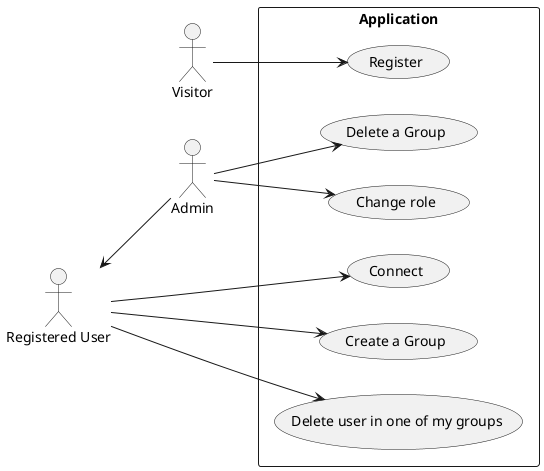
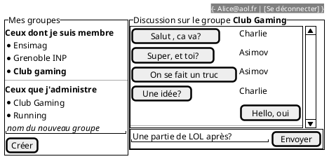

## Sonar cube badges

[](https://sonarqube.ensimag.fr/dashboard?id=TPFullstack_nolan_blanc)
[](https://sonarqube.ensimag.fr/dashboard?id=TPFullstack_nolan_blanc)
[](https://sonarqube.ensimag.fr/dashboard?id=TPFullstack_nolan_blanc)

---

title: Messaging App  
author:

- Blanc Nolan

---

## Installation

Dev mode (docker compose needed):
First create your .env files both in backend and frontend directories, you can use the .env.example files as a template.
To launch the backend and frontend in dev mode, you can use the following command in the project directory:

```sh
  npm run dev
```

This commande will create or restart a docker container for the postgres database, and then launch the backend and frontend in dev mode. The backend will be accessible at http://localhost:3000/api and the frontend at http://localhost:5173 and doc at http://localhost:3000/docs. The backend will be automatically restarted if you modify the code, and the frontend will be automatically reloaded if you modify the code.

> [!TIP] If you want to seed or reset the database, you can call the command with the following environment variables:
>
> ```sh
>  DB_SEED=true npm run dev # to seed the database
>  DB_RESET=true DB_SEED=true npm run dev # to reset and seed the database
> ```

prod (on aws):
TODO

## Architecture du code

### FrontEnd

```
frontend
|-- components.json
|-- cypress
|   |-- e2e
|   |   `-- connection.cy.js
|   |-- fixtures
|   `-- support
|-- cypress.config.js
|-- eslint.config.js
|-- index.html
|-- jsconfig.json
|-- package.json
|-- public
|-- README.md
|-- src
|   |-- App.css
|   |-- App.jsx
|   |-- assets
|   |   |-- hero.png
|   |   |-- react.svg
|   |   `-- vite.svg
|   |-- components
|   |   |-- auth
|   |   |-- group
|   |   |-- message
|   |   `-- ui
|   |-- contexts
|   |   |-- AuthContext.jsx
|   |   `-- SocketContext.jsx
|   |-- hooks
|   |   |-- useDiscussion.js
|   |   |-- useGroups.js
|   |   `-- useManageGroup.js
|   |-- index.css
|   |-- lib
|   |   `-- utils.js
|   |-- main.jsx
|   `-- views
|       |-- Accueil.jsx
|       `-- Connection.jsx
`-- vite.config.js
```

### Backend

#### Schéma de votre base de donnée

A modifier/compléter...

```plantuml
class User{
  name
  email
  passhash
  isAdmin : boolean
}

class Message{
  content
}

class Group{
  name
}

User "1" -- "n" Message : posts
Group "1" -- "n" Message : contains

User "n" -- "n"  Group : is member
User "1" -- "n"  Group : create and own
```

```
backend
|-- config
|   `-- config.js
|-- jest.config.js
|-- jest.setup.js
|-- migrations/       # folder containing the migration files for the database
|-- seeders/          # folder containing the seed files for the database
|-- package.json
|-- setup-test.sh     # script to setup the test database before running the tests
`-- src
    |-- __tests__     # folder containing the unit and integration tests
    |-- app.js        # entry point of the express app
    |-- controllers   # folder containing the controllers for the different endpoints
    |   |-- group.js
    |   |-- message.js
    |   `-- user.js
    |-- frontend
    |   `-- index.html
    |-- models        # folder containing the models for the database tables
    |   |-- database.js
    |   |-- groups.js
    |   |-- messages.js
    |   `-- users.js
    |-- routes        # folder containing the routes for the different endpoints
    |   |-- connection.js
    |   |-- group.js
    |   |-- message.js
    |   |-- protected.js
    |   `-- user.js
    |-- server.js   # entry point of the backend server
    |-- util        # folder containing utility functions for the backend
    |   |-- CodeError.js
    |   |-- logger.js
    |   |-- swagger.js
    |   `-- updatedb.js
    `-- websocket
        `-- websocket.js  # folder containing all websocket functions
```

### Gestion des rôles et droits

Expliquer ici les différents rôles mis en place, et comment ils sont gérés dans votre code.

- Coté backend

- Coté frontend

## Cahier des charges

Ici vous décrivez les fonctionnalités souhaitées et celles effectivement mises en oeuvre. Avec un diagramme UML des cas d'usage et des maquettes des vues souhaitées et des captures d'écran de ce qui a été réalisé.

### Cas d'usage

A modifier/compléter



### Maquettes

A modifier/compléter...



### Captures d'écran

A compléter

### API mise en place

Donner le lien vers la documentation swagger et/ou faire un tableau récapitulant l'API

A compléter

## Test

### Backend

Décrivez les tests faits au niveau du backend, leur couverture.

### Frontend

Décrivez les tests faits au niveau du backend, leur couverture.

## Intégration + déploiement (/3)

Décrivez ici les éléments mis en place au niveau de l'intégration continue
